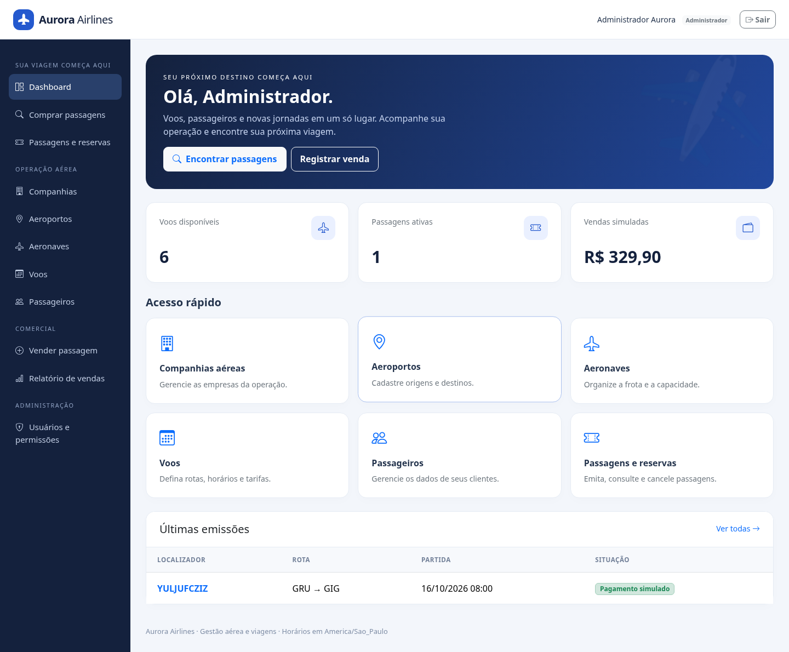

# Aurora Airlines — Laravel Airline

Projeto da aula de Tópicos Especiais.

Sistema de companhia aérea em Laravel 10, Bootstrap 5 e MySQL 8.4, com phpMyAdmin 5.2. Interface em português, adaptada a celular e desktop.

## Funcionalidades

| Entidade | Migration / Model | Controller e CRUD | Policy | Factory / Seeder |
| --- | --- | --- | --- | --- |
| Companhias aéreas | Airline | AirlineController | AirlinePolicy | AirlineFactory / AirlineSeeder |
| Aeroportos | Airport | AirportController | AirportPolicy | AirportFactory / AirportSeeder |
| Aeronaves | Aircraft | AircraftController | AircraftPolicy | AircraftFactory / AircraftSeeder |
| Voos | Flight | FlightController | FlightPolicy | FlightFactory / FlightSeeder |
| Passageiros | Customer | CustomerController | CustomerPolicy | CustomerFactory / CustomerSeeder |
| Passagens e reservas | Ticket | TicketController | TicketPolicy | TicketFactory / TicketSeeder |
| Usuários | User | UserController | UserPolicy | UserFactory / UserSeeder |

Cada CRUD possui listagem paginada, consulta, cadastro, edição, exclusão, validação e telas Blade. Os cadastros usam as views compartilhadas em resources/views/crud; passagens têm telas próprias. Rotas em routes/web.php.

Autenticação usa os recursos nativos do Laravel: guard de sessão, Auth, hashing de senha, recuperação via Password, cookies de lembrar acesso, CSRF e limitação de tentativas. Cadastro público sempre cria um cliente; somente administradores alteram perfis.

O dashboard reúne menus de entidades, indicadores, últimas emissões, busca de voos, compras, reservas, venda pelo atendente e relatório comercial.

## Perfis e autorização

| Recurso | Administrador | Atendente | Cliente |
| --- | --- | --- | --- |
| Companhias, aeroportos, aeronaves, voos | CRUD | CRUD | Busca de voos disponíveis |
| Passageiros | CRUD | CRUD | Consulta e edição do próprio perfil |
| Passagens / reservas | Emissão, consulta, pagamento simulado e cancelamento | Igual ao administrador | Compra, reserva e cancelamento próprios |
| Usuários e perfis | CRUD | Sem acesso | Cadastro e login públicos |
| Relatório de vendas | Acesso | Acesso | Sem acesso |

Policies protegem as ações dos controllers. Gates manage-airline, manage-users, view-sales e buy-tickets controlam funcionalidades e menus. O servidor verifica permissões mesmo quando uma URL é chamada diretamente.

Registros vinculados não podem ser excluídos. Uma passagem só pode ser excluída por funcionário depois de cancelada. O administrador não pode excluir a própria conta nem remover o próprio acesso administrativo ou o último administrador.

## Instalação

Requisitos: **PHP 8.1.4 ou superior** (validado com PHP 8.1.4), Composer 2.2+, Node.js 22.12+ ou 24 e Docker com Compose. Extensões PHP: PDO, pdo_mysql, mbstring, intl, curl, fileinfo, openssl, tokenizer, XML/DOM e zip. pdo_sqlite permite rodar a suíte rápida de testes.

Na pasta extraída Laravel-Airline, execute:

~~~bash
php scripts/configure-env.php
composer install
docker compose up -d --wait
php artisan migrate --seed
npm ci
npm run build
php artisan serve
~~~

Em Linux/macOS, bash scripts/setup.sh executa a preparação completa; depois inicie o servidor PHP. O comando composer setup prepara a aplicação quando o banco já estiver disponível. Para trabalhar com atualização automática dos assets, use composer dev.

O script configure-env.php cria .env, uma chave Laravel e senhas aleatórias para o banco e as contas de demonstração. Valores já configurados são preservados, inclusive uma senha de MySQL explicitamente vazia em um .env existente. Não há senha padrão no código. O .env não integra o ZIP nem o Git.

O servidor de desenvolvimento PHP utiliza a porta **8000**. MySQL usa **3306**; phpMyAdmin usa **8081**. Os serviços Docker são publicados apenas na interface local. Para um ambiente em nuvem, use o mecanismo de acesso/encaminhamento de portas da sua plataforma.

Se houver conflito de portas, configure MYSQL_PORT, DB_PORT e PHPMYADMIN_PORT no .env. MySQL mantém os dados no volume Docker mysql_data. docker compose stop preserva o volume; docker compose down -v remove os dados.

### Windows com PHP 8.1.4 e MySQL/phpMyAdmin existentes (sem Docker)

1. Baixe novamente o ZIP atualizado do GitHub e extraia em uma **pasta nova**. Não copie vendor, node_modules ou bootstrap/cache da versão anterior (Laravel 12).
2. Inicie o MySQL no seu painel local, por exemplo XAMPP. No phpMyAdmin, crie um banco vazio chamado airline, com collation utf8mb4_unicode_ci.
3. Abra o PowerShell na pasta extraída e execute:

~~~powershell
php -v
php scripts/configure-env.php
~~~

4. Abra o arquivo .env em um editor e configure seu banco. Por exemplo, em um XAMPP local cujo usuário root esteja sem senha:

~~~dotenv
DB_CONNECTION=mysql
DB_HOST=127.0.0.1
DB_PORT=3306
DB_DATABASE=airline
DB_USERNAME=root
DB_PASSWORD=
~~~

Se seu MySQL usa senha ou outra porta, informe os valores reais da sua instalação. Não utilize a senha gerada para o Docker em um MySQL existente: configure a senha que seu banco já utiliza.

5. Continue no PowerShell:

~~~powershell
composer install
composer check-platform-reqs
php artisan optimize:clear
php artisan migrate --seed
npm ci
npm run build
php artisan serve
~~~

6. No navegador do seu computador, abra http://localhost:8000. Entre com admin@aurora.test e a senha presente em DEMO_ADMIN_PASSWORD no .env.

Para usar um banco já preenchido pela versão anterior, preserve seu .env e faça backup do banco; nenhuma migration de entidades foi alterada. Depois execute php artisan migrate --seed, que mantém os registros existentes.

Se optar por atualizar na mesma pasta, preserve seu .env e remova a pasta vendor antiga e os arquivos PHP gerados em bootstrap/cache antes de executar composer install (preserve o arquivo .gitignore). Utilize o composer.json e o composer.lock **novos**. Nunca edite vendor/composer/platform_check.php e não utilize --ignore-platform-reqs.

### Limite desta versão de compatibilidade

Laravel 10 e PHP 8.1 estão fora do suporte de segurança. Esta adaptação atende ao uso local/acadêmico com o PHP existente; não é recomendada para publicação em produção. O Composer informa quatro avisos de segurança no framework legado. Detalhes estão em docs/VALIDACAO.md. Nenhuma verificação de plataforma, assinatura, TLS ou auditoria foi desabilitada.

### Acessos de demonstração

| E-mail | Perfil | Senha local |
| --- | --- | --- |
| admin@aurora.test | Administrador | Valor de DEMO_ADMIN_PASSWORD no seu .env |
| agent@aurora.test | Atendente | Valor de DEMO_AGENT_PASSWORD no seu .env |
| customer@aurora.test | Cliente | Valor de DEMO_CUSTOMER_PASSWORD no seu .env |

Seeders são repetíveis: não recriam cadastros existentes nem redefinem senhas. Alterar uma variável de senha após o primeiro seed não altera uma conta já criada; use a tela de usuários ou a recuperação de senha.

No phpMyAdmin, o servidor é mysql, o usuário é o valor de DB_USERNAME (padrão airline) e a senha é o valor de DB_PASSWORD. O usuário da aplicação tem acesso ao banco airline. Se precisar administrar usuários/bancos, use root com MYSQL_ROOT_PASSWORD, somente no ambiente de desenvolvimento.

### MySQL existente / XAMPP

Também é possível usar um MySQL já instalado e seu phpMyAdmin. Execute php scripts/configure-env.php; configure DB_HOST, DB_PORT, DB_DATABASE, DB_USERNAME e DB_PASSWORD no .env para o banco existente; crie um banco vazio e execute os comandos Composer, migrations e npm acima. Nesse caso, não é necessário iniciar o Docker.

Esta versão foi adaptada para PHP 8.1.4 / Laravel 10. Ative as extensões exigidas pelo Composer no php.ini caso alguma esteja desabilitada. O arquivo composer.lock fixa dependências compatíveis com PHP 8.1.4.

### Arquivo SQL para phpMyAdmin

database/sql/airline.sql contém o esquema MySQL e o histórico das migrations, sem usuários, senhas ou dados pessoais. A forma recomendada é php artisan migrate --seed.

Como alternativa, importe esse arquivo em um **banco vazio** pelo phpMyAdmin e execute php artisan db:seed. O histórico incluído evita que o Laravel tente recriar as mesmas tabelas. Novas migrations podem ser aplicadas normalmente. O SQL foi gerado e validado com MySQL 8.4; não é um dump para SQLite ou PostgreSQL.

## Fluxo de compra e venda

1. Administrador/atendente cadastra companhia, aeroportos e aeronave; cria um voo com origem diferente do destino, horários válidos e preço em reais.
2. Cliente se cadastra e completa seu documento no perfil; busca um voo e compra ou reserva uma passagem para si.
3. Atendente pode emitir para qualquer passageiro cadastrado, escolhendo o voo e a forma de pagamento simulado.
4. O preço é calculado no servidor e armazenado em centavos na passagem. Alterações posteriores da tarifa do voo não alteram passagens já emitidas.
5. Reservas e passagens pagas ocupam lugares. Uma transação com bloqueio de linha no MySQL impede vender o último lugar duas vezes. Não é permitido emitir duas passagens ativas para o mesmo passageiro no mesmo voo.
6. Reservas podem ser pagas; passagens podem ser canceladas antes da partida. Cancelamento libera o lugar. Passagens canceladas não podem ser reativadas.
7. Voos com passagens emitidas preservam companhia, rota, aeronave e horários. Cancelar um voo cancela suas passagens ativas e preserva os dados de pagamentos simulados.
8. Vendas de voos passados, cancelados ou de companhias inativas são bloqueadas. Aeronaves não podem reduzir sua capacidade abaixo das passagens ativas de um voo.
9. O relatório soma apenas passagens atualmente pagas, excluindo reservas e cancelamentos.

Reservas não expiram automaticamente antes da partida. Cada passagem corresponde a um passageiro; não há grupos, escolha de assentos, bagagem, check-in ou integração com sistemas reais de companhias.

**Pagamentos, Pix, cartões e estornos são simulados.** Não são coletados dados de cartão. Para cobrança real, integre um provedor com confirmação por webhook e regras próprias de reembolso.

## Recuperação de senha

Por padrão, MAIL_MAILER=log: links de recuperação são gravados em storage/logs/laravel.log para desenvolvimento. Para envio real, configure SMTP no .env; credenciais devem permanecer fora do Git.

## Testes

Suíte funcional rápida, com SQLite em memória e dados isolados:

~~~bash
php artisan test
~~~

Também foi validada a suíte funcional no MySQL, em banco separado. Crie airline_test e dê ao usuário de testes permissão apenas sobre esse banco. Nos containers de desenvolvimento, pode-se criar o banco/permissões pelo phpMyAdmin com acesso administrativo.

Depois, em Linux/macOS:

~~~bash
DB_CONNECTION=mysql DB_DATABASE=airline_test php artisan test
php vendor/bin/phpunit -c phpunit.mysql.xml
~~~

A segunda configuração executa o teste de duas vendas simultâneas para um único lugar. Requer MySQL e pcntl (Linux), além do banco exclusivo airline_test. O teste recusa um banco cujo nome não termina em _test.

**As suítes recriam tabelas do banco de testes. Nunca aponte os testes para um banco com dados que deseja conservar.** A configuração padrão utiliza SQLite em memória; a configuração de concorrência força o banco airline_test.

Os testes cobrem autenticação/recuperação, todos os CRUDs, perfis/Gates, privacidade de passagens, preço calculado no servidor, lotação, emissão duplicada, reservas, cancelamentos, integridade relacional e repetibilidade dos seeders.

## Organização

- app/Models: entidades e relacionamentos.
- app/Http/Controllers: autenticação, CRUDs, dashboard, portal de compras e perfil.
- app/Policies e app/Providers/AppServiceProvider.php: autorização.
- app/Services: transações de passagens e proteção de voos.
- database/migrations, database/factories, database/seeders: esquema e dados de desenvolvimento.
- resources/views: telas Blade em português.
- resources/css e resources/js: Bootstrap e assets compilados por Vite.
- compose.yaml: MySQL e phpMyAdmin.
- scripts: preparação da configuração e instalação.
- tests/Feature e tests/MySql: validação funcional e concorrência.

O ZIP inclui os assets compilados, os arquivos de lock e o SQL. Exclui .env, .git, vendor, node_modules, logs, sessões e dados locais do banco. Instale as dependências antes de executar.
